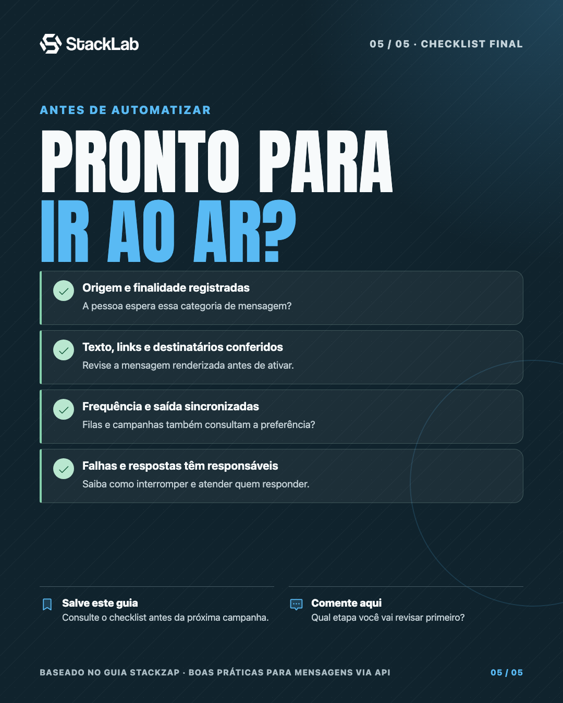

# Instagram Carousel Skill

Crie carrosséis para Instagram com uma narrativa visual clara, conteúdo conciso e design adaptado à marca fornecida no pedido. A skill pode criar HTML e imagens prontas para publicar; o exemplo incluso mostra uma aplicação StackLab com cinco telas.

## Instalação

Instale somente esta skill pelo CLI `skills`:

```sh
npx skills add magdielcardoso/instagram-carousel-skill --skill instagram-carousel
```

Depois, invoque `$instagram-carousel` e forneça o conteúdo, o público, o número de telas e a identidade visual desejada. Se esses detalhes estiverem em um site, repositório ou anexos, indique-os no pedido.

## Exemplo incluído

O exemplo é um carrossel StackLab de cinco telas sobre boas práticas para mensagens via API de WhatsApp. Ele usa HTML/CSS, assets locais, ícones Phosphor, fonte Anton e exportação PNG em 1080 × 1350 px.

<table>
  <tr>
    <td align="center"><strong>Abertura</strong><br></td>
    <td align="center"><strong>Tela final</strong><br></td>
  </tr>
</table>

- [Fonte HTML e assets](examples/stacklab-whatsapp-api/)
- [Instruções para exportar o exemplo](examples/stacklab-whatsapp-api/README.md)
- Conteúdo baseado no artigo [Boas práticas para enviar mensagens com uma API de WhatsApp](https://blog.stackzap.com.br/boas-praticas/boas-praticas-mensagens-api-de-whatsapp/).

A presença dos arquivos de marca StackLab ilustra a adaptação do exemplo; use a identidade fornecida para cada novo pedido. As licenças da fonte e dos ícones estão na pasta `assets/` do exemplo.
